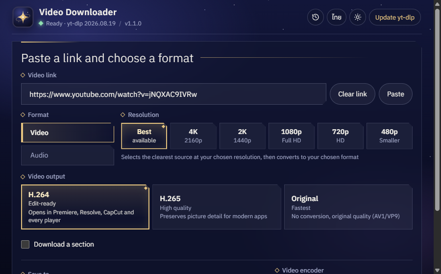
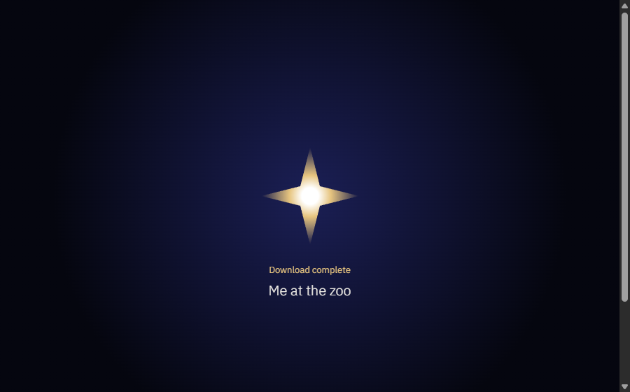

<div align="center">


# StarPort

**Paste a link. Get the file. Look good doing it.**

A video and audio downloader for Windows.

[](https://github.com/Sorryhxm/StarPort/releases/latest)
[](https://github.com/Sorryhxm/StarPort/releases)

[](LICENSE)

[**Download**](https://github.com/Sorryhxm/StarPort/releases/latest) · [Report a bug](https://github.com/Sorryhxm/StarPort/issues) · [ภาษาไทย](#ภาษาไทย)



</div>

## Why StarPort

Most yt-dlp apps make you download first and find out later. StarPort shows you what you're getting before you
press the button, then gets out of your way.

- **See it first.** Paste a link and a card shows the thumbnail, title, length, and the best quality that actually exists.
- **Keep only the good part.** Set a start and end time like `1:20` → `2:45` and get a frame-accurate clip.
- **Line them up.** Paste a whole list of links at once, or keep adding while one downloads. The queue runs itself.
- **Ready for your editor.** Save as H.264 for Premiere, Resolve and CapCut, smaller H.265, or the untouched original.
- **Uses your GPU.** NVIDIA, Intel and AMD encoders are detected and tested automatically, with the CPU as fallback.
- **Audio too.** MP3, FLAC or WAV.
- **Remembers.** History keeps your last 50 downloads, one click from their folder.
- **Knows when you're away.** A Windows notification when the queue finishes, and a little warp when you're watching.

<div align="center">

</div>

## Get started

1. Download **[StarPort-Setup.exe](https://github.com/Sorryhxm/StarPort/releases/latest/download/StarPort-Setup.exe)** and run it.
2. On first launch, click **Install tools**. StarPort fetches yt-dlp and FFmpeg (about 170 MB) and verifies their checksums.
3. Paste a link and press **Start download**.

> [!NOTE]
> StarPort isn't code signed yet, so Windows may say *"Windows protected your PC"*. Click **More info → Run anyway**.

> [!TIP]
> Don't want to install? Grab [StarPort.exe](https://github.com/Sorryhxm/StarPort/releases/latest/download/StarPort.exe),
> the portable version. The installed version updates itself; the portable one tells you when a new version is out.

Works with YouTube, TikTok, Facebook, X and [every site yt-dlp supports](https://github.com/yt-dlp/yt-dlp/blob/master/supportedsites.md).

### If YouTube says "confirm you're not a bot"

StarPort retries on its own first. If YouTube still refuses, click **Sign in to YouTube** in the app once.
Your cookies stay on your PC, and **Sign out of YouTube** deletes them.

## Build it yourself

You need [Node.js](https://nodejs.org/) 22 or newer.

```bash
npm install
npm start       # run from source
npm run dist    # build StarPort-Setup.exe and StarPort.exe into dist/
```

Run the tests with `npm run test:clip`, `test:checksum`, `test:download-path`, `test:updater`, `test:language`
or `test:startup`.

## Privacy

No accounts, no analytics, no tracking. StarPort only goes online to download the links you give it, fetch and
update its tools from GitHub, and check for new StarPort releases.

## Credits

StarPort is built on the download engine of [FramePort](https://github.com/CandyCoreProj/FramePort) by CandyCore,
and runs on [yt-dlp](https://github.com/yt-dlp/yt-dlp) and [FFmpeg](https://ffmpeg.org/). Bundled components keep
their own licenses; see [THIRD_PARTY_NOTICES.md](THIRD_PARTY_NOTICES.md).

Only download what you have the right to use.

---

<details>
<summary><h2 id="ภาษาไทย">ภาษาไทย</h2></summary>

**วางลิงก์ ได้ไฟล์ สวยตั้งแต่เปิดแอป**

StarPort เป็นโปรแกรมดาวน์โหลดวิดีโอและเสียงสำหรับ Windows ที่ให้คุณเห็นก่อนว่าจะได้อะไร แล้วค่อยกดดาวน์โหลด

- **ดูก่อนโหลด** วางลิงก์แล้วเห็นภาพปก ชื่อ ความยาว และความละเอียดสูงสุดที่มีจริง
- **ตัดเฉพาะช่วง** ใส่เวลาเริ่มและจบ เช่น `1:20` ถึง `2:45` ได้คลิปตรงเวลา
- **ต่อคิวได้** วางหลายลิงก์พร้อมกัน หรือเพิ่มระหว่างที่กำลังโหลด
- **พร้อมตัดต่อ** เลือก H.264, H.265 หรือไฟล์ต้นฉบับ
- **ใช้ GPU** รองรับ NVIDIA, Intel และ AMD เลือกตัวที่เร็วที่สุดให้เอง
- **เสียงอย่างเดียว** MP3, FLAC หรือ WAV
- **มีประวัติ** เปิดโฟลเดอร์ของไฟล์เก่าได้ในคลิกเดียว
- **แจ้งเตือน** เมื่อคิวดาวน์โหลดเสร็จ

### เริ่มใช้งาน

1. ดาวน์โหลด **[StarPort-Setup.exe](https://github.com/Sorryhxm/StarPort/releases/latest/download/StarPort-Setup.exe)** แล้วติดตั้ง
2. เปิดครั้งแรกให้กด **ติดตั้งเครื่องมือ** แอปจะโหลด yt-dlp และ FFmpeg (ประมาณ 170 MB) และตรวจ checksum ให้
3. วางลิงก์แล้วกด **เริ่มดาวน์โหลด**

> [!NOTE]
> StarPort ยังไม่ได้เซ็น code signing ถ้า Windows ขึ้นว่า *"Windows protected your PC"* ให้กด **More info → Run anyway**

ถ้า YouTube ขอให้ยืนยันว่าไม่ใช่บอท แอปจะลองใหม่ให้เองก่อน ถ้ายังไม่ผ่าน กด **เข้าสู่ระบบ YouTube** ในแอปหนึ่งครั้ง
คุกกี้เก็บไว้ในเครื่องคุณเท่านั้น

ดาวน์โหลดเฉพาะเนื้อหาที่คุณมีสิทธิ์ใช้

</details>
